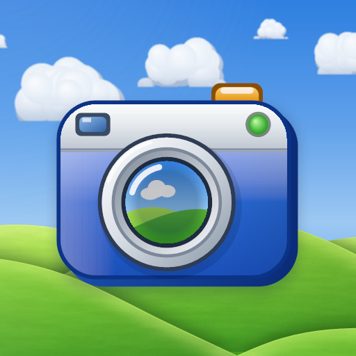
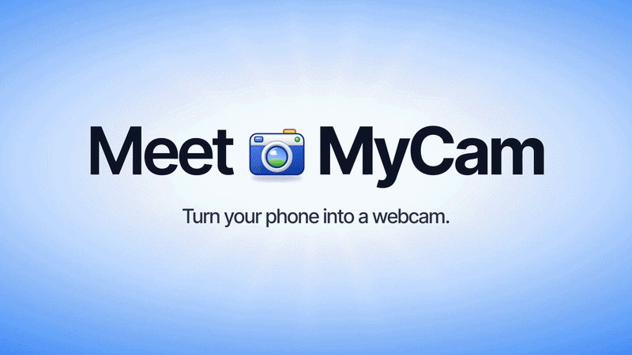
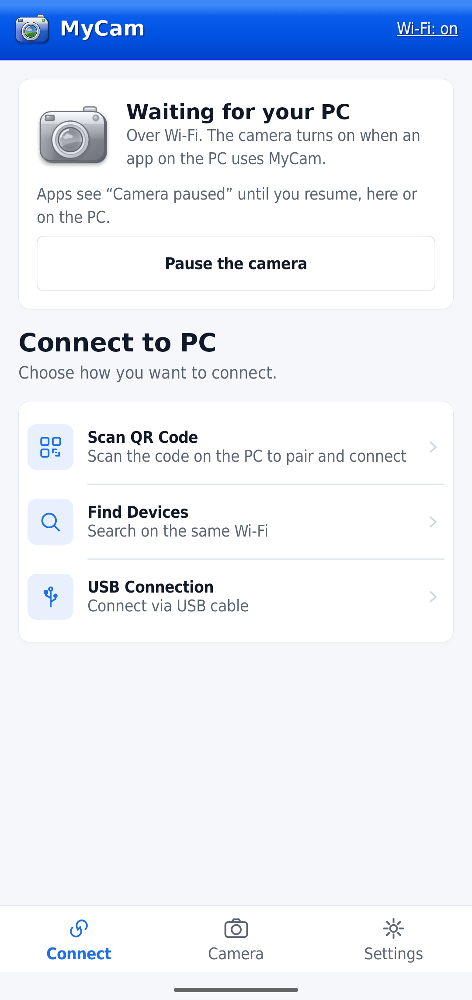
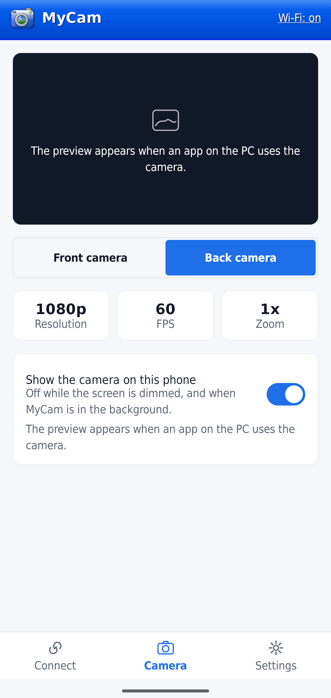
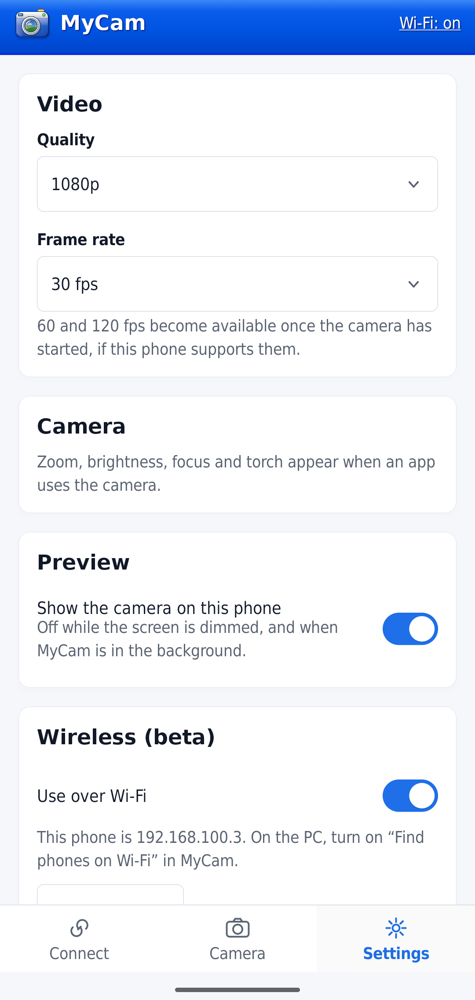

> This directory contains MyCam-derived source integrated into PHONE_CAMERA.
> The historical upstream README below describes MyCam; for current PHONE_CAMERA
> setup, product names and verification status, see the [repository README](../../README.md).

  

<h1 align="center">MyCam</h1>

<b>Turn your phone into a webcam for Windows.</b>

<a href="https://mycam.dev">mycam.dev</a>

  
  
  

  

MyCam shows up as a camera called **MyCam** on your Windows PC (10 or 11) — in Zoom, Teams, OBS, browsers,
and the Windows Camera app — fed live by your phone. Plug in an Android phone and it just works; scan a QR
code on an iPhone and nothing even needs installing.

## Why MyCam

- **Plug and play.** No Developer Options, no USB debugging, no ADB. Plug in an Android phone over USB, or
  pair it over Wi-Fi once — either way, Windows just sees a webcam.
- **iPhone and iPad, with nothing to install.** The PC itself serves a page; scan a QR code in Safari and
  you're live.
- **Front and back cameras**, real resolutions and frame rates (up to 4K, up to 120 fps where the phone
  supports it) — MyCam only ever offers what *your* phone can actually do.
- **Privacy first, by design, not by promise.**
  - Pause from the phone, its notification, or the PC tray — instantly, from either side.
  - The camera turns off by itself the moment Windows locks.
  - A PC has to be explicitly allowed by the phone before it gets real video, even once paired — a QR code
    is consent to *pair*, not consent to be *watched*.
  - While paused or not yet allowed, other apps see a "Camera paused" picture, never a frozen or black frame.
- **A free, open-source alternative** to proprietary phone-webcam apps, with no ads, no account, no cloud —
  video only ever goes from your phone to your own PC.

## Screenshots

  
  
  

## Get MyCam

| | |
|---|---|
| **Windows (PC)** | Download `MyCam-Setup-X.Y.Z.exe` from the [latest release](https://github.com/whoissaaif/mycam/releases/latest) and run it. |
| **Android** | Download `MyCam-X.Y.Z.apk` from the same release and install it (or build from source — see [Architecture → Build and test](docs/ARCHITECTURE.md#build-and-test-from-source)). |
| **iPhone / iPad** | Nothing to install — see [iPhone](#iphone) below. |

### Setting it up

1. Install MyCam on the PC. The installer registers the virtual camera, installs the
   [UsbDk](https://github.com/daynix/UsbDk) driver if needed (signed, hash-checked), and adds the firewall
   rule the iPhone page needs.
2. **Android, over USB:** plug in the phone. The first time, it asks to open MyCam — tick **Always** —
   and Windows asks for admin once, to give the accessory mode its driver.
3. **Android, over Wi-Fi:** turn on "Find phones on Wi-Fi" on the PC and scan the code from the phone, or
   pair once with a 6-digit code.
4. **iPhone:** see [iPhone](#iphone) below.
5. Choose **MyCam** as the camera in any app.

Left-click the tray icon for the settings window (camera, mirror, devices, start with Windows); right-click
it for the quick menu.

## iPhone

An iPhone has no app to install. The companion serves a small HTTPS page itself:

1. On the PC, open MyCam and choose **Connect an iPhone**. A QR code appears.
2. On the iPhone, open the Camera app, point it at the code, and tap the link. The first time, Safari
   warns the connection isn't private (it's a self-signed certificate) — tap through it once.
3. Tap **Start**, and allow the camera and motion sensors.

The iPhone is remembered after that — open the page again from history, or **Share → Add to Home Screen**,
and there's no code to scan again. Both devices need to be on the same network, and Windows needs to call
it **Private**.

Resolution, frame rate, zoom and torch are chosen on the PC, from what the iPhone reports it can do. Wired
iPhone support isn't ready yet; see [docs/iphone-wired.md](docs/iphone-wired.md) for the plan. The full
protocol and architecture are in [docs/ARCHITECTURE.md](docs/ARCHITECTURE.md#iphone).

## Troubleshooting

The companion writes `%LOCALAPPDATA%\MyCam\mycam.log`, including the phone's own messages ("phone says:
…"). It records each step: phone found, switched to accessory mode, connected, camera started, frames
decoded. Exit MyCam from the tray rather than killing it — a killed companion can leave the phone stuck
until it's replugged.

**iPhone:**
- **The link doesn't open:** both devices must be on the same network, and Windows must call it
  **Private**. Some guest and office Wi-Fi networks block devices from reaching each other.
- **The page says the PC is busy:** another phone is already using MyCam (a phone on the cable always
  wins).
- **The page asks to scan the code again:** the iPhone was forgotten on the PC, or Safari's site data was
  cleared.
- **The picture freezes when the iPhone locks:** expected — Safari stops the camera in the background, and
  the session waits 5 minutes for you to return.

## Known limits

- **Windows 10 (1809+) or 11.** On Windows 11, MyCam uses the `MFCreateVirtualCamera` Frame Server API;
  on Windows 10, which has no equivalent, a DirectShow source filter instead (the same approach OBS
  Virtual Camera uses) — the installer registers whichever one your PC needs.
- **Android:** needs Android Open Accessory support (nearly all phones from the last 10+ years have it).
  While the companion is running, a plugged-in Android phone switches to webcam mode, so MTP file transfer
  isn't available — exit MyCam from the tray to transfer files.
- **iPhone:** needs a browser with WebCodecs H.264 (current Safari); works over the network only (wired is
  a plan, not yet shipped); the page must stay open in front, since iOS stops the camera when Safari is
  backgrounded.

## Contributing

Bug reports and small fixes are welcome — see [CONTRIBUTING.md](CONTRIBUTING.md) for how to build, test,
and what the pull request checklist expects. [docs/ARCHITECTURE.md](docs/ARCHITECTURE.md) has the full
technical picture: how the pieces fit together, the repo layout, and the wire protocol.

## License

MIT. See [LICENSE](LICENSE). Third-party parts keep their own licenses:
- [libusb](https://libusb.info) (LGPL-2.1, vendored in `pc/third_party/libusb`, trimmed to the Windows
  backend MyCam builds).
- [qrcodegen](https://www.nayuki.io/page/qr-code-generator-library) by Project Nayuki (MIT, vendored in
  `pc/third_party/qrcodegen`).
- [UsbDk](https://github.com/daynix/UsbDk) (Apache-2.0, downloaded by the installer build).
- [DejaVu fonts](https://dejavu-fonts.github.io) (Bitstream Vera licence, with the DejaVu changes in the
  public domain).

The Windows XP look is an homage drawn from scratch: no Microsoft artwork or fonts are included.
